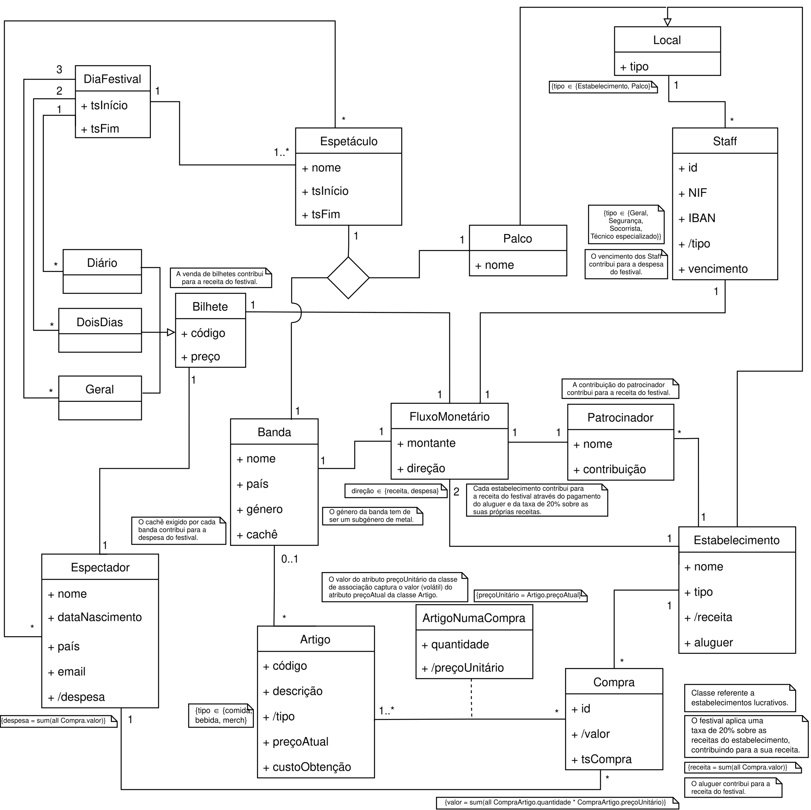

# Evil Live Music Festival (2025 edition) Management Database

* This repository contains the database design and implementation for the [Evil Live Music Festival](https://evillive.rocks/) (2025 edition) management system.

* [Submission 1](./BD_Submission1_0501.pdf): domain description and conceptual modelling.
* [Submission 2](./BD_Submission2_0501/): relational modelling, functional dependencies, normal forms and SQL creation and population files.

*Final Conceptual Database Model*
